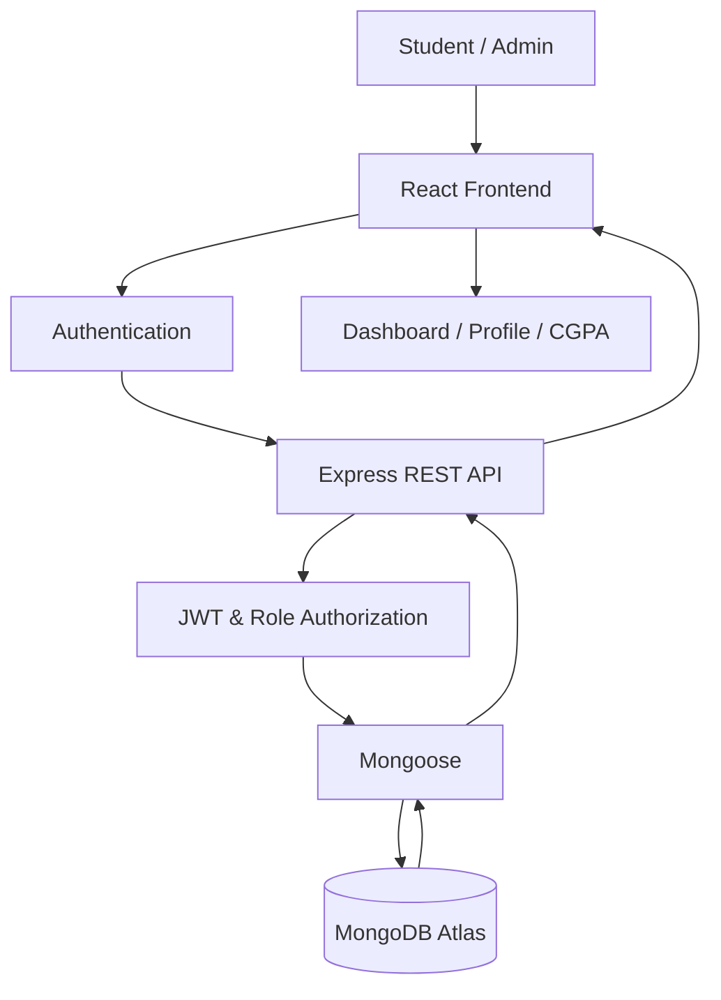

# 🚀 GrowX — Private Academic Platform

### Your Academics. Your Progress. Your Future.

A modern, full-stack academic management platform designed to help students manage semester-wise academic records, calculate SGPA and CGPA, track backlogs, and monitor their academic performance — all in one place.

<p align="center">
  
  
  
</p>

<p align="center">
  <a href="https://grow-x-academic-platform--rohith46181.replit.app/"><b>🌐 Live Demo</b></a> •
  <a href="#-features"><b>Features</b></a> •
  <a href="#-screenshots"><b>Screenshots</b></a> •
  <a href="#-installation"><b>Installation</b></a> •
  <a href="#-author"><b>Author</b></a>
</p>

---

## 📌 Overview

**GrowX** is a private academic platform built to simplify academic record management for college students.

Students can maintain their semester-wise subject details, enter marks and credits, automatically calculate grades, SGPA and CGPA, and access their saved academic records whenever they log in.

The platform also provides an administrative dashboard where administrators can create and manage student accounts and oversee academic information.

## ✨ Features

### 🎓 Student Portal

- 🔐 Secure student authentication
- 👋 Personalized dashboard with full student name
- 👤 Student profile with roll number and academic information
- 📚 Semester-wise academic management
- ➕ Add and manage semesters
- 📝 Add, edit and delete subjects
- 🎯 Automatic grade and grade-point calculation
- 📊 Automatic SGPA calculation
- 🏆 Overall CGPA calculation
- ⚠️ Backlog tracking
- 📈 Academic performance overview
- 📋 Semester-wise results
- 💾 Persistent academic records
- 🚪 Secure logout and session management

### 🛡️ Admin Dashboard

- 🔐 Dedicated administrator login
- 📊 Administrative overview dashboard
- 👥 Create and manage student accounts
- ✏️ Edit student profiles
- 🔎 Search and filter students
- 🎓 Manage student branches and academic details
- 📚 Manage semester-wise academic records
- 📝 Manage subjects, marks and credits
- 🔑 Reset student passwords
- 📈 View student CGPA, SGPA and backlogs
- 🔒 Role-based access control

### 🎨 User Experience

- 🌙 Dark mode
- ☀️ Light mode
- 💎 Modern glassmorphism-inspired interface
- 📱 Responsive design
- ⚡ Smooth navigation and interactions
- 🎯 Clean dashboard layouts
- 🔔 User-friendly notifications

---

## 🧮 Academic Calculation System

GrowX automatically calculates grades, SGPA and CGPA based on the configured grading system.

### Grading Scale

| Marks Range | Grade | Grade Point |
|---|---|---:|
| 90–100 | O | 10 |
| 80–89 | A+ | 9 |
| 70–79 | A | 8 |
| 60–69 | B+ | 7 |
| 50–59 | B | 6 |
| 40–49 | C | 5 |
| Below 40 | F | 0 |

*The grading scale is configurable according to the institution's academic regulations.*

### SGPA Calculation

SGPA is calculated using:

\[
SGPA = \frac{\sum(C_i \times G_i)}{\sum C_i}
\]

Where:

- \(C_i\) = Subject credits
- \(G_i\) = Grade point obtained

### CGPA Calculation

CGPA is calculated using the credit-weighted average:

\[
CGPA = \frac{\sum(C_i \times G_i)}{\sum C_i}
\]

The calculation considers all included semester subjects and their respective credits.

### Backlog Calculation

A subject is considered a backlog when its marks are below the configured passing threshold or its grade is F.

---

## 🛠️ Tech Stack

| Technology | Purpose |
|---|---|
| React.js | Frontend UI |
| Vite | Frontend build tool |
| Node.js | Backend runtime |
| Express.js | REST API |
| MongoDB Atlas | Cloud database |
| Mongoose | Database modelling |
| JWT | Authentication |
| bcrypt | Password hashing |
| CSS | Styling and responsive UI |
| React Icons / Lucide | Interface icons |

<p align="center">
  
</p>

---

## 🏗️ System Architecture



### Data Flow

1. Student or administrator logs in.
2. Backend validates credentials.
3. Authentication session is established.
4. Frontend requests authorized academic information.
5. Backend retrieves records from MongoDB.
6. Students manage their academic records.
7. Changes are saved permanently in the database.
8. Saved information is restored on subsequent logins.

---

## 📸 Screenshots

Add your actual application screenshots in the repository's `screenshots/` folder.

| Page | Screenshot |
|---|---|
| Login | `screenshots/login.png` |
| Student Dashboard | `screenshots/dashboard.png` |
| Student Profile | `screenshots/profile.png` |
| CGPA Calculator | `screenshots/cgpa-calculator.png` |
| Semester Management | `screenshots/semesters.png` |
| Admin Dashboard | `screenshots/admin-dashboard.png` |
| Student Management | `screenshots/admin-students.png` |

Example:

```markdown

```

---

## 📂 Project Structure

Example recommended structure:

```text
GrowX/
│
├── client/
│   ├── public/
│   └── src/
│       ├── components/
│       ├── pages/
│       ├── layouts/
│       ├── context/
│       ├── services/
│       ├── hooks/
│       ├── routes/
│       └── utils/
│
├── server/
│   ├── config/
│   ├── controllers/
│   ├── middleware/
│   ├── models/
│   ├── routes/
│   ├── services/
│   ├── seed/
│   └── server.js
│
├── .gitignore
├── README.md
└── package.json
```

*Adjust this structure to match the actual repository.*

---

## ⚙️ Installation

### 1. Clone the Repository

```bash
git clone YOUR_GITHUB_REPOSITORY_URL
```

### 2. Navigate to the Project

```bash
cd GrowX
```

### 3. Install Dependencies

Install frontend dependencies:

```bash
cd client
npm install
```

Install backend dependencies:

```bash
cd ../server
npm install
```

### 4. Configure Environment Variables

Create a `.env` file inside the backend directory.

```env
PORT=5000
MONGO_URI=your_mongodb_connection_string
JWT_SECRET=your_secure_random_secret
FRONTEND_URL=http://localhost:5173
```

Create a frontend `.env` file:

```env
VITE_API_URL=http://localhost:5000
```

**Security:** Never commit `.env` files, database passwords, JWT secrets, or real student credentials to GitHub.

### 5. Start the Backend

```bash
cd server
npm run dev
```

### 6. Start the Frontend

Open another terminal:

```bash
cd client
npm run dev
```

Open the local development URL displayed by Vite.

*Note: Update the commands above to match the actual scripts in your package.json files.*

---

## ☁️ Deployment

GrowX can be deployed using:

| Service | Purpose |
|---|---|
| Vercel | Frontend hosting |
| Render | Backend hosting |
| MongoDB Atlas | Cloud database |

### Deployment Architecture

```text
          Vercel
     React Frontend
             |
             ▼
          Render
      Express Backend
             |
             ▼
       MongoDB Atlas
        Cloud Storage
```

Configure the production environment variables:

**Backend**

```env
PORT=5000
MONGO_URI=your_mongodb_connection_string
JWT_SECRET=your_secure_secret
FRONTEND_URL=your_frontend_url
```

**Frontend**

```env
VITE_API_URL=your_backend_url
```

Never expose database credentials in frontend code.

---

## 🔐 Security

GrowX follows important application security practices:

- Password hashing with bcrypt.
- JWT-based authentication.
- Role-based authorization.
- Protected administrative routes.
- Student-specific academic data access.
- Environment-based secret management.
- Server-side academic calculations.
- Input validation.
- Database-backed data persistence.

---

## 🗺️ Future Enhancements

- 📄 Academic transcript PDF generation
- 📊 Advanced academic analytics
- 📈 Performance charts and semester comparisons
- 📤 Excel import/export
- 🔔 Academic reminders and notifications
- 📱 Progressive Web App support
- 🎓 Digital academic reports
- 📚 Subject-wise performance insights

---

## 🤝 Contributing

Contributions, suggestions and improvements are welcome.

1. Fork this repository.
2. Create a feature branch.
3. Commit your changes.
4. Push your branch.
5. Open a Pull Request.

---

## 👨‍💻 Author

**Perumalla Rohith**

Full Stack Developer | AI & ML Enthusiast

- 🌐 Portfolio: [rohith06-portfolio.netlify.app](https://rohith06-portfolio.netlify.app/)
- 💻 GitHub: [rohith-1806](https://github.com/rohith-1806)
- 📸 Instagram: [@broo_codeee_](https://www.instagram.com/broo_codeee_/)

---

## ⭐ Support

If you find GrowX useful, consider giving this repository a ⭐ on GitHub.

Your support motivates further development!

---

<p align="center">
  <b>Built with ❤️ to make academic management smarter.</b>
  <br/>
  <strong>GrowX — Track Your Progress. Own Your Growth.</strong>
</p>
